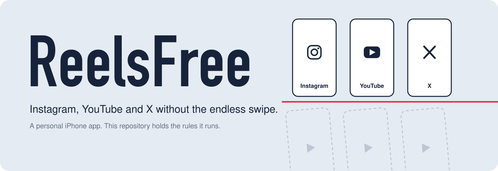
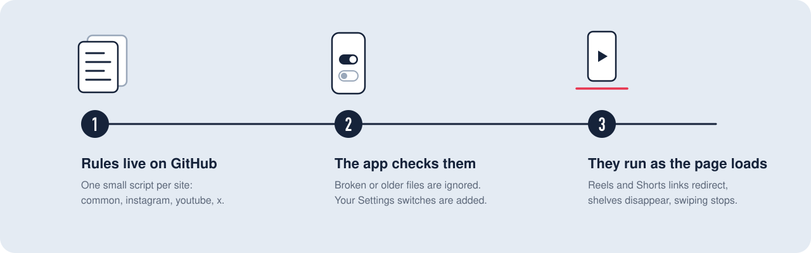

  

ReelsFree is a personal iPhone app that opens the mobile websites of Instagram, YouTube and X and removes their short-video feeds. You keep your home feed, messages, profiles and search. Reels, Shorts and the algorithmic "For you" timeline are gone.

This repository holds the blocking rules the app runs. When a site changes and something slips back in, the fix lands here and reaches the phone without reinstalling the app.

## What gets removed

| Site | Stays | Removed |
| --- | --- | --- |
| Instagram | Home feed, stories, DMs, profiles, search | Reels tab and feed, profile Reels tab, Explore grid, swiping from one reel to the next |
| YouTube | Home, subscriptions, search, regular videos | Shorts tab, shelves and cards, swipe between Shorts, Playables games |
| X | Following timeline, DMs, notifications, profiles | "For you" tab, swipeable video player, promoted posts |

A reel or Short someone sends you still opens, on its own. There is no next one to swipe to.

## How it works

  

1. The app downloads every file in this repository when it opens, at most once every 15 minutes.
2. It keeps the new set only if every file parses and its version is not older than the rules built into the app. Otherwise it keeps what it had.
3. Before each page loads, the app injects your Settings switches, the site's rule file and `common.js`.

## Settings

Every protection can be switched off per site in the app's Settings screen. A switched-off feature is skipped by the rule file, so you choose which parts of each site stay.

| Site | Switches |
| --- | --- |
| Instagram | Reels tab, reel swiping, profile Reels tab, Explore, "Open the app" banners |
| YouTube | Shorts, Shorts swiping, Playables, background audio |
| X | "For you", video swiping, promoted posts, "Open the app" banners |

## Files

| File | Job |
| --- | --- |
| [`common.js`](common.js) | Shared runtime: redirects, hidden elements, swipe detection, the version line |
| [`instagram.js`](instagram.js) | Instagram rules |
| [`youtube.js`](youtube.js) | YouTube rules |
| [`x.js`](x.js) | X rules |

Each site file sets `window.ReelsFreeRules` and checks `on("<switch>")` before each rule. With no settings present, every rule is on.

## Updating the rules

1. Edit the site's file and, if needed, `common.js`.
2. Raise the version on the first line of `common.js`, for example `2026-11-16.2` to `2026-11-16.3`. An unchanged or lower version is ignored by newer app builds.
3. Push. GitHub's raw file cache can take a few minutes; the phone picks the change up the next time the app opens.

Keep these files identical to `ReelsFree/Rules/` in the app's source.

## Safety

These scripts run inside pages where you are signed in. Only the repository owner can change them. Keep two-factor sign-in on the GitHub account that owns this repository.

---

Personal project. Not affiliated with Instagram, YouTube or X.
